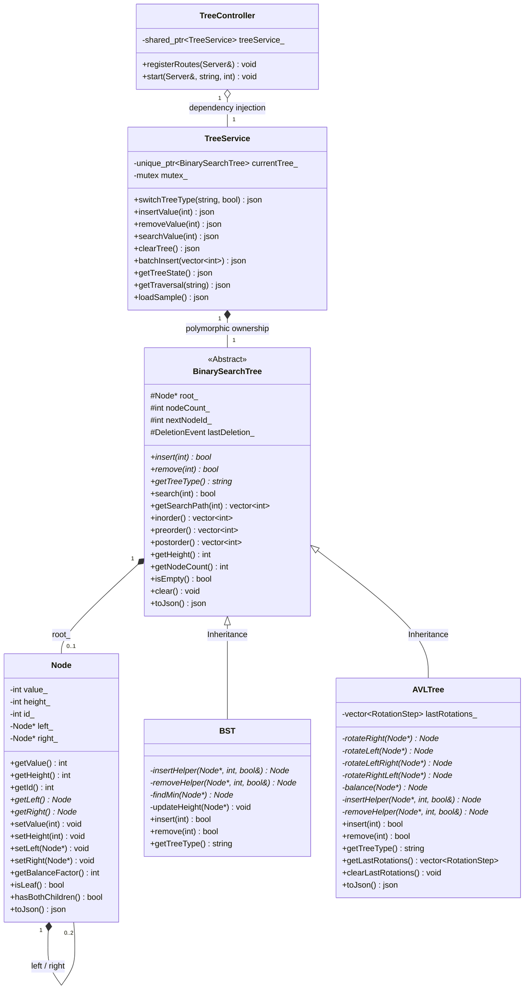

# Binary Tree & AVL Tree OOP Simulation

Interactive, real-time visualization of Binary Search Trees (BST) and self-balancing AVL Trees built with a modern **C++17 Object-Oriented Programming (OOP)** backend and a minimalistic neon-green SVG/HTML5 frontend connected via a high-performance REST API.

## Demo

https://github.com/user-attachments/assets/4c70d301-0dd9-401d-95e0-677c35d3f1f9

---

## Architecture & OOP Class Hierarchy

The project follows a clean, decoupled 3-tier architecture (**Model-Service-Controller**) adhering strictly to core Object-Oriented Programming principles.



---

## Detailed OOP Classes Breakdown

### 1. Domain Model Classes (`models/`)

#### [`Node`](models/Node.h) — Encapsulated Tree Entity
Represents an individual node within the binary tree topology.
- **Attributes (Private)**:
  - `value_` (`int`): The numerical key stored in the node.
  - `height_` (`int`): Subtree height (1 for leaf nodes).
  - `id_` (`int`): Unique auto-incremented identifier for client-side DOM/SVG tracking and animations.
  - `left_`, `right_` (`Node*`): Pointers to left and right child subtrees.
- **Methods**: Public getters/setters, topological queries (`isLeaf()`, `hasLeft()`, `hasRight()`, `hasBothChildren()`), `getBalanceFactor()` ($height_{left} - height_{right}$), and recursive `toJson()` serialization.
- **Copy Restrictions**: Disallows individual copying via `= delete` on copy constructor and assignment operator to avoid accidental shallow pointer duplicates.

#### [`BinarySearchTree`](models/BinarySearchTree.h) — Abstract Base Class (ABC)
Defines the standardized interface, invariants, and shared logic for binary search trees.
- **Attributes (Protected)**:
  - `root_` (`Node*`): Pointer to the root node.
  - `nodeCount_` (`int`): Current node count.
  - `nextNodeId_` (`int`): Counter issuing distinct node IDs.
  - `lastDeletion_` (`DeletionEvent`): Telemetry structure capturing details of the most recent deletion (e.g., inorder successor swaps for 2-children deletions).
- **Pure Virtual Interface (`= 0`)**:
  - `virtual bool insert(int value) = 0;`
  - `virtual bool remove(int value) = 0;`
  - `virtual std::string getTreeType() const = 0;`
- **Shared Implementations**:
  - Full traversals (`inorder()`, `preorder()`, `postorder()`).
  - Search routines and animated traversal paths (`search()`, `getSearchPath()`).
  - Structural queries (`getHeight()`, `getNodeCount()`, `isEmpty()`, `clear()`).
  - Complete JSON serialization of the tree hierarchy (`toJson()`).
- **Memory Management (Rule of 5)**: Implements virtual destructor, copy constructor, copy assignment operator, move constructor, and move assignment operator with deep-cloning (`cloneSubtree`) and recursive teardown (`destroySubtree`).

#### [`BST`](models/BST.h) — Concrete Unbalanced Binary Search Tree
Concrete subclass inheriting from `BinarySearchTree`.
- **Specialization**: Implements standard binary search tree insertion and deletion without automatic balancing.
- **Algorithms**: Uses recursive descent for insertion and inorder successor replacement when deleting nodes with two children.

#### [`AVLTree`](models/AVLTree.h) — Concrete Self-Balancing Tree
Concrete subclass inheriting from `BinarySearchTree` implementing Adelson-Velsky & Landis (AVL) self-balancing.
- **Balance Invariant**: Guarantees $|BF(node)| \le 1$ across every node in $O(\log n)$ time.
- **Balancing Rotations**:
  - **LL Rotation (`rotateRight`)**: Single clockwise rotation for left-heavy imbalances.
  - **RR Rotation (`rotateLeft`)**: Single counter-clockwise rotation for right-heavy imbalances.
  - **LR Rotation (`rotateLeftRight`)**: Double rotation (left on child, right on root).
  - **RL Rotation (`rotateRightLeft`)**: Double rotation (right on child, left on root).
- **Nested Telemetry Structure (`RotationStep`)**: Logs rotation metadata (type, pivot, root, grandchild, direction, human-readable rationale, and before/after tree snapshots) so the frontend can orchestrate step-by-step visual balancing morphs.

---

### 2. Service & Controller Classes (`services/` & `controllers/`)

#### [`TreeService`](services/TreeService.h) — Business Logic & State Coordinator
Acts as the intermediary between network controllers and domain tree models.
- **Polymorphic Management**: Stores active tree via `std::unique_ptr<BinarySearchTree> currentTree_`.
- **Dynamic Mode Switching**: Switches runtime modes between `"BST"` and `"AVL"` on the fly (`switchTreeType()`), seamlessly preserving existing nodes.
- **Concurrency Control**: Guards concurrent REST API requests across worker threads using `std::mutex mutex_`.
- **Lifecycle Protection**: Non-copyable/non-movable (`= delete`) to ensure single-source-of-truth service state.

#### [`TreeController`](controllers/TreeController.h) — REST API Controller
Handles HTTP networking, request deserialization, input validation, and response serialization.
- **Dependency Injection**: Injected with `std::shared_ptr<TreeService>` through its constructor.
- **Route Registration**: Configures endpoints on `httplib::Server` (e.g., `/api/tree`, `/api/insert`, `/api/delete`, `/api/search`, `/api/traversal/:type`, `/api/sample`, `/api/clear`).
- **Separation of Concerns**: Contains zero tree algorithm logic; exclusively manages HTTP status codes, CORS headers, and JSON translation.

---

### 3. Frontend OOP Classes (`frontend/`)

- **`TreeVisualizer` (`tree-visualizer.js`)**: Encapsulates SVG canvas operations, coordinate layout calculations (inorder spacing with collision prevention), pan/zoom transformations, bezier swap animations, and rotation arc rendering.
- **`QuantumAudio` (`app.js`)**: Synthesizer class encapsulating Web Audio API oscillators and gain nodes for procedural harmonic sound feedback during operations.
- **`CosmosApp` (`app.js`)**: Client-side application controller orchestrating DOM event listeners, REST API communications, telemetry displays, and animation execution.

---

## OOP Concepts Applied in the Project

| OOP Concept | Implementation in this Project |
| :--- | :--- |
| **Abstraction** | The `BinarySearchTree` base class defines an abstract contract (`insert`, `remove`, `search`, etc.) hiding complex recursive pointers, height recalculations, and tree balancing details from external callers. |
| **Encapsulation** | `Node` variables (`value_`, `height_`, `id_`, `left_`, `right_`) and tree state (`root_`, `nodeCount_`) are declared `private`/`protected`. Modification occurs exclusively through validated accessors, mutators, and topological query methods. |
| **Inheritance** | `BST` and `AVLTree` inherit publicly from `BinarySearchTree` (`class BST : public BinarySearchTree`, `class AVLTree : public BinarySearchTree`), reusing traversals, search algorithms, height calculations, and serialization logic without code duplication. |
| **Polymorphism (Dynamic Dispatch)** | Pure virtual methods in `BinarySearchTree` allow `TreeService` to hold a base pointer (`std::unique_ptr<BinarySearchTree>`) and invoke `currentTree_->insert(...)` or `currentTree_->remove(...)`. At runtime, the C++ vtable dynamically dispatches execution to either `BST` or `AVLTree` without conditional type checking. |
| **Separation of Concerns** | Clear architectural division across layers: **Models** handle data structures and algorithms, **Services** manage state and concurrency, **Controllers** manage HTTP and routing, and the **Frontend** manages rendering and animation. |
| **Composition & Aggregation** | Trees are composed of dynamic `Node` instances; `TreeService` owns a `BinarySearchTree` via composition (`std::unique_ptr`); `TreeController` aggregates `TreeService` via `std::shared_ptr`; `AVLTree` contains `RotationStep` structures. |
| **RAII & Rule of 5** | All heap-allocated tree nodes are systematically managed using RAII. `BinarySearchTree` adheres to the C++ **Rule of 5** (destructor, copy/move constructors, and copy/move assignment operators) to prevent memory leaks and dangling pointers. |
| **Dependency Injection** | `TreeController` receives `std::shared_ptr<TreeService>` via constructor injection, eliminating tight coupling between HTTP routing and service creation. |

---

## REST API Specification

| Method | Endpoint | Description |
| :--- | :--- | :--- |
| `GET` | `/api/tree` | Returns current tree state, node count, height, traversals, and full JSON hierarchy. |
| `POST` | `/api/insert` | Inserts a node `{ "value": 42 }`, performing rotations if AVL. |
| `POST` | `/api/delete` | Deletes a node `{ "value": 42 }`, performing swaps and rebalancing. |
| `GET` | `/api/search?value=42` | Searches for key and returns the exact ordered search path for animation. |
| `POST` | `/api/tree/type` | Switches active tree variant `{ "type": "BST" \| "AVL", "preserve": true }`. |
| `GET` | `/api/traversal/:type` | Returns ordered traversal array for `inorder`, `preorder`, or `postorder`. |
| `POST` | `/api/sample` | Resets and loads a pre-populated balanced sample tree. |
| `POST` | `/api/clear` | Clears all nodes from the tree. |

---

## Getting Started

### 1. Clone the Repository
```bash
git clone https://github.com/Nodal-leaf/Binary-Tree-Visualizer.git
cd Binary-Tree-Visualizer
```

### 2. One-Click Launch (Windows)
Double-click **`run.bat`** or run:
```cmd
run.bat
```
*(Also supports PowerShell via `.\run.ps1` or Python via `python main.py`)*

### 3. Linux / macOS / EC2 Build & Run
```bash
cmake -B build -S .
cmake --build build -j$(nproc)
./build/tree_server 8080
```
Open **`http://127.0.0.1:8080`** (or your EC2 public IP) in any modern browser.

### 4. Running the C++ Unit Test Suite
Verify encapsulation, BST operations, all 4 AVL rotations (LL, RR, LR, RL), complex balance sequences, and base pointer polymorphism:
```bash
./build/test_trees
```
```text
========================================
   BST & AVL TREE OOP CORE TEST SUITE   
========================================
Running Test: Node Encapsulation & Queries...
✓ Node Encapsulation passed.
Running Test: BST Operations (Insert, Traversals, Search, Delete)...
✓ BST Operations passed.
Running Test: AVL LL Rotation...
✓ AVL LL Rotation verified: Left-Left imbalance at node 30: performed single Right Rotation (clockwise) around pivot 20
Running Test: AVL RR Rotation...
✓ AVL RR Rotation verified: Right-Right imbalance at node 10: performed single Left Rotation (counter-clockwise) around pivot 20
Running Test: AVL LR Rotation...
✓ AVL LR Rotation verified: Left-Right imbalance at node 30: Step 1: Left rotation on child 10; Step 2: Right rotation on root 30
Running Test: AVL RL Rotation...
✓ AVL RL Rotation verified: Right-Left imbalance at node 10: Step 1: Right rotation on child 30; Step 2: Left rotation on root 10
Running Test: AVL Complex Sequences & Rebalancing on Deletion...
✓ AVL Complex Sequence & Deletion passed.
Running Test: Polymorphism & Abstraction via Base Pointer...
✓ Polymorphism verified: BST height = 5, AVL height = 3
========================================
 ALL OOP UNIT TESTS PASSED SUCCESSFULLY! 
========================================
```
